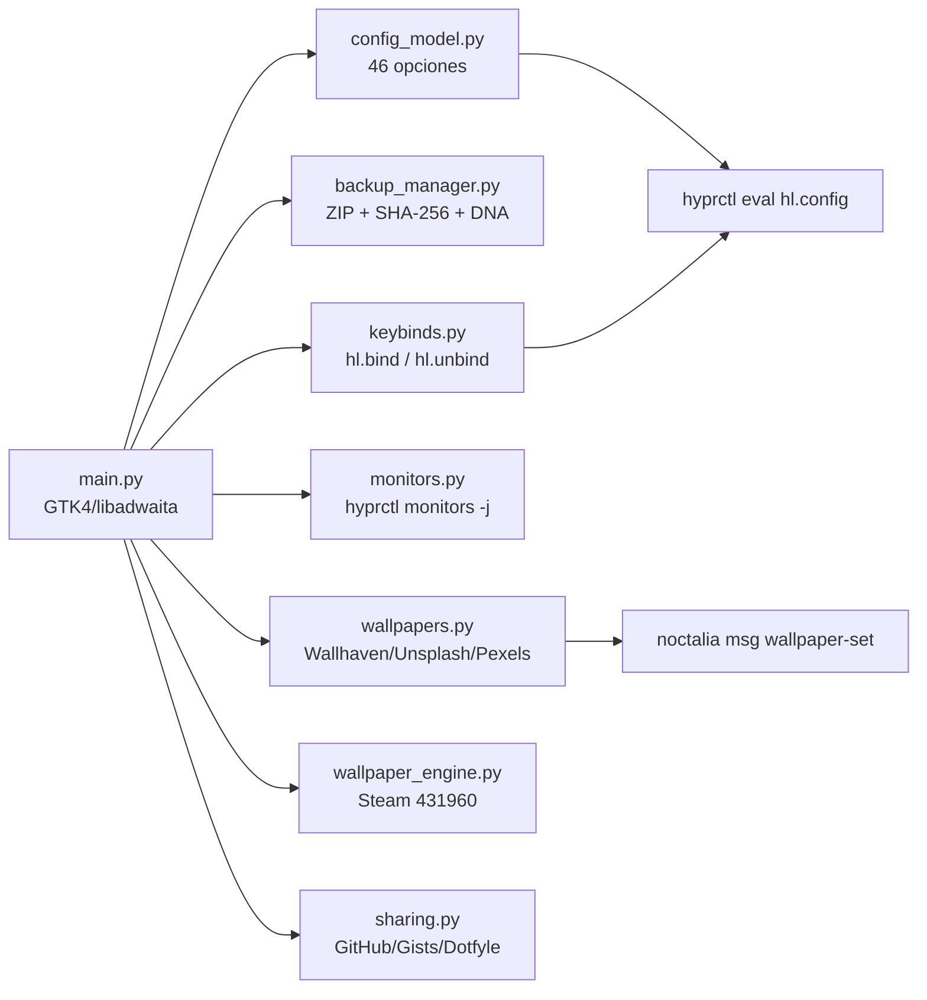

# Ricing HGUI

[](https://www.python.org/)
[](https://gtk.org/)
[](https://hyprland.org/)
[](investigacion/)
[](sources/)
[](archivo-web/INDICE.md)

**Investigación exhaustiva sobre *ricing* + una GUI propia para personalizar Hyprland sin escribir código.**

Este repositorio documenta el escritorio real de CachyOS + **Hyprland 0.57.2**
(configuración **Lua**) + **Noctalia 5.6.0**, y contiene un prototipo funcional de
interfaz gráfica que aplica cambios **en vivo**, hace **backups automáticos**,
gestiona **keybindings**, detecta **monitores**, busca **wallpapers** y permite
**compartir/configurar desde la web**.

> Idioma: los documentos están en **español**; comandos, rutas y código conservan
> su forma técnica original.

---

## ✨ Qué incluye

| Área | Detalle |
|---|---|
| 📚 Investigación | 18 documentos: cultura del ricing, arquitectura, color (WCAG calculado), tipografía, iconos, animaciones, wallpapers, dotfiles, comunidad, herramientas GUI, cómo crear tu GUI, archivo web e inventario de **184 opciones** |
| 🗂️ Fuentes | 49 páginas primarias archivadas con proveniencia (URL, título, fecha, conversor) |
| 🌐 Archivo web | **744 páginas oficiales** de 42 sitios (wiki de Hyprland, docs de Noctalia, wikis de GitHub, sitios de herramientas) |
| 🖥️ Perfil real | Inventario de 1232 paquetes, GPU, monitor, paletas y copias de los dotfiles del autor |
| 🧪 GUI (`recursos/hypr-rice-gui/`) | 9 pestañas, 46 opciones con controles generados desde un modelo, vista previa en vivo, backups automáticos, historial de puntos en el pasado, identidad Config DNA, keybinds editables, monitores, wallpapers e integración web |

### Pestañas de la GUI

`Backups` · `Historial` · `Identidad` · `Opciones` · `Keybinds` · `Aplicaciones` · `Monitores` · `Wallpapers` · `Web / Compartir`

- **Opciones**: 46 parámetros reales con tipo, rango y ruta (`general.gaps_in`,
  `decoration.blur.passes`, `misc.vrr`, `theme.mode`…). Sliders para *intensidad*,
  switches para booleanos, desplegables para enumerados. Cambios en vivo con
  `hyprctl eval "hl.config({...})"`.
- **Backups**: automáticos (antes de guardar y cada N minutos), retención,
  SHA-256, verificación y restauración; el botón *Guardar* sólo persiste.
- **Historial**: cualquier punto en el pasado; ver archivo, comparar, restaurar o borrar.
- **Identidad**: huella `DNA-XXXX-XXXX` con etiquetas y notas; agrupa backups iguales.
- **Keybinds**: ver los ~108 atajos activos, capturar teclas, editar con un menú en
  lenguaje natural (sin Lua), desactivar sin borrar, reactivar y eliminar.
- **Aplicaciones**: navegador principal y secundario, terminal, gestor de archivos,
  editor y calculadora; escribe `variables.lua`, sincroniza `uwsm-env` y añade el
  atajo del navegador secundario (`SUPER + SHIFT + W`).
- **Monitores**: autodetección con `hyprctl monitors -j`; escribe `MONITOR1..3`.
- **Wallpapers**: Wallhaven, Unsplash, Pexels, archivos locales y Wallpaper Engine.
  **Filtro automático por monitor**: proportionally + resolución nativa (p. ej.
  1440×900 → `ratios=8x5`, `atleast=1440x900`) para que el fondo nunca se vea raro.
- **Web / Compartir**: buscar rices en GitHub/Gists/Dotfyle, ver README, importar
  repos, generar ZIP sin secretos y publicar a Gist con token opcional.

### Esquema de atajos de workspaces

| Atajo | Acción |
|---|---|
| `SUPER + 1…0` | Enfocar el workspace N de este monitor |
| `SUPER + ALT + 1…3` | Enfocar el monitor N |
| `SUPER + CTRL + 1…0` | Enfocar el workspace absoluto N |
| `SUPER + SHIFT + 1…0` | **Mover la ventana al workspace N (siguiendo)** |
| `SUPER + SHIFT + CTRL + 1…3` | **Mover la ventana al monitor N** |
| `SUPER + SHIFT + ALT + 1…0` | Mover la ventana al workspace N sin seguir |

---

## 🚀 Inicio rápido

Requisitos (ya presentes en CachyOS): `python3`, `python-gobject`, `gtk4`, `libadwaita`, `hyprctl`, `noctalia`.

```bash
git clone https://github.com/CarlosAntonioAceaJimenezCD/Ricing-HGUI.git
cd Ricing-HGUI/recursos/hypr-rice-gui
python3 main.py
```

Para que los keybinds creados sobrevivan al reinicio, añade a
`~/.config/hypr/hyprland.lua`:

```lua
require("config.ui-bindings")
```

> El prototipo escribe `ui-settings.lua`, `ui-bindings.lua` y `config.toml` con
> backups previos. Revisa los diff antes de conservarlos.

---

## 🧠 Arquitectura



Cada módulo lleva una cabecera **AUDITORÍA** con efectos externos, invariantes y
seguridad. El prototipo no pide root, no guarda tokens y excluye secretos de los backups.

---

## 📖 Documentos

| # | Documento | Tema |
|---|---|---|
| 00 | [Perfil del sistema](00-perfil-del-sistema.md) | Auditoría real del equipo |
| 01–04 | [Qué es ricing](investigacion/01-que-es-ricing.md) · [Hyprland 0.57](investigacion/02-hyprland-0-57.md) · [Arquitectura](investigacion/03-arquitectura-de-un-rice.md) · [Componentes](investigacion/04-componentes-del-escritorio.md) | Fundamentos |
| 05–09 | [Color](investigacion/05-sistema-de-colores.md) · [Tipografía](investigacion/06-tipografia.md) · [Iconos](investigacion/07-iconos-y-cursores.md) · [Animaciones](investigacion/08-animaciones-y-efectos.md) · [Wallpapers](investigacion/09-wallpapers-y-generative-theming.md) | Diseño |
| 10–13 | [Dotfiles](investigacion/10-dotfiles-y-gestion.md) · [Comunidad](investigacion/11-comunidad-y-recursos.md) · [Hoja de ruta](investigacion/12-hoja-de-ruta-personalizada.md) · [Glosario](investigacion/13-glosario.md) | Práctica |
| 14–17 | [Herramientas GUI](investigacion/14-herramientas-gui-de-ricing.md) · [Crear tu GUI](investigacion/15-crear-tu-propia-gui.md) · [Archivo web](investigacion/16-archivo-web-oficial.md) · [Inventario de opciones](investigacion/17-inventario-de-opciones.md) · [Áreas de personalización](investigacion/18-areas-de-personalizacion.md) | Extensión |

Índices: [fuentes](sources/) · [archivo web](archivo-web/INDICE.md) ·
[configuración auditada](configuracion-actual/) · [apéndices](apendices/).

---

## 🔐 Seguridad

- Los tokens de GitHub/Unsplash/Pexels se introducen en la GUI y **no se escriben en disco**.
- Si usaste un PAT en la terminal, **revócalo** y genera uno nuevo.
- El ZIP compartible excluye `fish_variables`, keyrings, cachés y `.git`.
- Las fuentes externas conservan la licencia de sus autores; este repo documenta y cita.

## 🤝 Contribuir

1. Haz fork / rama nueva.
2. Añade opciones en `config_model.py` (una fila) y la GUI las generá sola.
3. Verifica con `python3 -m py_compile *.py` y ejecuta `python3 main.py`.
4. Aporta documentación en español con citas a `sources/`.

## 📄 Licencia

Código y documentación propios: **MIT**. Las fuentes en `sources/`, `archivo-web/` y
los repositorios clonados conservan sus licencias originales (Hyprland, Noctalia,
Catppuccin, Nerd Fonts, etc.).

---

*Proyecto de investigación y herramienta de aprendizaje. No afiliado a Hyprland,
Noctalia, Wallhaven, Dotfyle ni Valve.*
