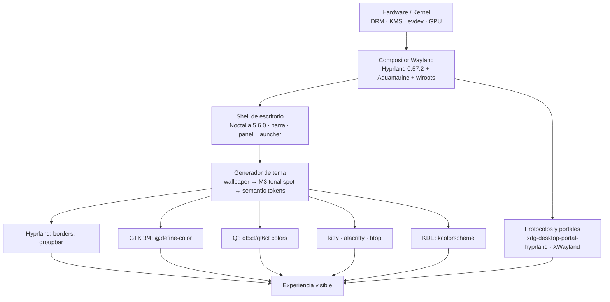
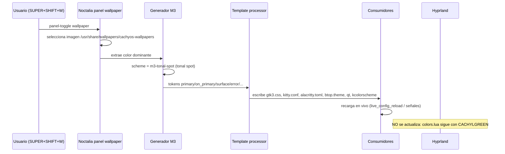
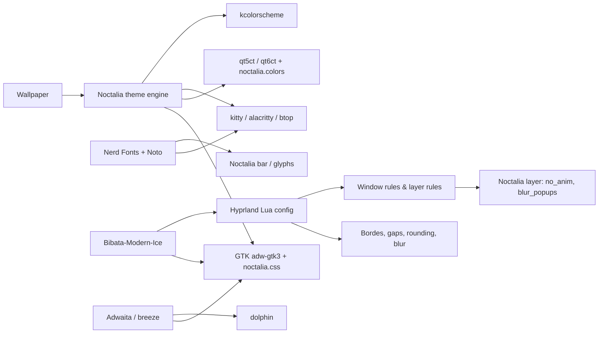

# 03 · Arquitectura de un rice: capas, flujos y puntos de control

> Un "rice" no es una imagen de fondo con bordes redondeados: es un **sistema**
> donde varias capas independientes comparten señales (color, tipografía, escala,
> símbolos) y reaccionan a eventos. Entender la arquitectura es lo que permite
> pasar de copiar dotfiles a diseñar un escritorio propio y mantenible.

## 1. El modelo de seis capas



| Capa | Responsabilidad | Dueño en este sistema | Punto de fallo típico |
|---|---|---|---|
| 1. Hardware | DRM/KMS, GPU, entrada, monitores | Kernel `7.3.5-cachyos`, Intel Sandy Bridge | GPU sin VRR/HDR; blur costoso |
| 2. Compositor | Ventanas, workspaces, focus, animaciones, blur | `hyprland 0.57.2`, config Lua | Config `.conf` obsoleta, `code:` vs caracteres (AZERTY) |
| 3. Shell | Barra, bandeja, notificaciones, launcher, sesión | `noctalia 5.6.0` + `noctalia-greeter` | `noctalia msg` cambiando entre versiones |
| 4. Motor de tema | Extraer color del wallpaper y derivar paleta | Noctalia (`m3-tonal-spot`) | Fuentes de color duplicadas (Cachy green vs M3) |
| 5. Consumidores | Apps que aplican la paleta | GTK, Qt, kitty, alacritty, btop | Templates desactualizados, apps que ignoran el tema |
| 6. Dotfiles | Persistencia, reproducibilidad, versionado | `~/.config/**`, `~/.local/share/**` (hoy sin git) | Cambios no rastreables, secretos versionados |

**Idea clave:** la capa 4 es el "cerebro". En el rice actual, Noctalia lee el
wallpaper, genera una paleta Material You y la inyecta en siete destinos
(`btop`, `gtk3`, `gtk4`, `kcolorscheme`, `kitty`, `qt`, `alacritty`). Hyprland,
en cambio, **no recibe** esa paleta: usa los tokens verdes de `colors.lua`.
Ésa es la fractura arquitectural más importante del sistema.

## 2. Flujo de un cambio de wallpaper (lo que realmente ocurre)



Fuentes: [`noctalia-theming-palette.md`](../sources/2026-11-21-noctalia-theming-palette.md),
[`noctalia-theming-templates.md`](../sources/2026-11-21-noctalia-templates.md),
[`noctalia-wallpaper.md`](../sources/2026-11-21-noctalia-wallpaper.md).

### 2.1 Por qué importa "tonal spot"

`m3-tonal-spot` es una de las estrategias de Material You: genera una paleta
tonal a partir de un **color semilla** del wallpaper. Noctalia expone otros
esquemas; la elección determina si el acento es vibrante o apagado y cómo se
distribuyen los tonos claros/oscuros. En modo `dark`, el fondo es gris oscuro
(`#1e1e20` en el resultado actual) y el acento es `#6791e4`. La teoría de
Material Color Utilities describe este proceso como extracción de un color
semilla y generación de tonos perceptualmente espaciados; ver
[`material-you-color-system.md`](../sources/2026-11-21-material-you-color-system.md).

> **Consecuencia práctica:** cambiar el wallpaper cambia *todo* el escritorio
> menos los bordes de Hyprland y el gradiente de splash. Para unificar, hay que
> meter los tokens de Noctalia en `colors.lua` (noctalia ya trae una plantilla
> `assets/templates/hyprland/hyprland.lua`, véase el repo clonado).

## 3. El stack como cadena de dependencias



Dependencias críticas detectadas en el perfil:

1. **`noctalia msg` como bus de control.** Casi todos los keybinds son IPC a
   Noctalia (`hl.dsp.exec_cmd(noctCall .. "...")`). Si Noctalia no arranca, el
   escritorio pierde volumen, brillo, lock, screenshots, launcher y clipboard.
   Hyprland queda como "simple" compositor. Es un acoplamiento alto pero
   deliberado: un solo punto para personalizar.
2. **`swash` como utilidad de captura.** Noctalia delega screenshot y clipboard
   de imagen a `swash --stdin --name …`. No es `grim`/`slurp`.
3. **UWSM como gestor de sesión.** `uwsm app -- <app>` lanza las apps como
   unidades systemd de usuario; las variables de entorno van en
   `~/.config/uwsm/env`, no en `environment.lua`. Esto explica por qué ese
   archivo está casi vacío y por qué `autostart.lua` sólo lanza 3 comandos.
4. **XWayland presente.** `xorg-xwayland 24.1.15` + `force_zero_scaling=true`
   para apps X11 como Steam o Winetricks. Las reglas de `windowrules.lua`
   incluyen un arreglo para drags de XWayland (`fix-xwayland-drags`).

Fuentes: [`noctalia-hyprland-integration.md`](../sources/2026-11-21-noctalia-hyprland-integration.md),
[`hyprland-master-tutorial.md`](../sources/2026-11-21-hyprland-master-tutorial.md),
[`hyprland-binds.md`](../sources/2026-11-21-hyprland-binds.md).

## 4. Anatomía de un archivo de configuración moderno (Lua)

Hyprland 0.56.1 añadió un aviso de deprecación a los `.conf` y 0.57 consolidó
la API `hl.*` ([`hyprland-releases.md`](../sources/2026-11-21-hyprland-releases.md)).
El rice actual ya usa el patrón recomendado:

```lua
-- hyprland.lua: punto de entrada, sólamente require()
require("config.animations")
require("config.colors")
require("config.decorations")
-- ...
```

Cada módulo usa una familia distinta de la API:

| Familia API | Qué define | Ejemplo real del usuario |
|---|---|---|
| `hl.config({...})` | Config declarativa por categorías | `hl.config({ general = { gaps_in = 3, ... } })` |
| `hl.curve(name, {...})` | Curvas bezier / spring reutilizables | `hl.curve("quick", { type="bezier", points={...} })` |
| `hl.animation({...})` | Animación por leaf | `hl.animation({ leaf="windows", spring="easy", style="slide" })` |
| `hl.bind(key, action, opts)` | Keybinds con acciones dsp | `hl.bind("ALT + Tab", hl.dsp.window.cycle_next())` |
| `hl.window_rule({...})` | Reglas por class/title/content/xdg_tag | reglas de `steam_app.*`, PiP, diálogos |
| `hl.layer_rule({...})` | Reglas para capas (shells, overlays) | `namespace = "^noctalia-(bar-.+|...)$"` |
| `hl.workspace_rule({...})` | Workspaces persistentes por monitor | `workspace="1", monitor=MONITOR1, default=true` |
| `hl.monitor({...})` | Salidas | `output=MONITOR1, mode="preferred"` |
| `hl.on(event, callback)` | Eventos | `hl.on("hyprland.start", function() ... end)` |
| `hl.exec_cmd` / `hl.dsp.exec_cmd` | Ejecución | `hl.exec_cmd("noctalia")` |
| `hl.get_config` / `hl.config` | Lectura/escritura en caliente | `zoomfunction()` usa `cursor:zoom_factor` |
| `hl.gesture({...})` | Gestos táctiles | 4 dedos horizontal → workspace |

La modularidad permite **aislar dominios**: cambiar `colors.lua` no toca los
binds; cambiar `windowrules.lua` no afecta animaciones. Es la misma idea que los
*design tokens* del desarrollo web: separar valores de su uso.

## 5. Puntos de extensión ( dónde insertar mejoras)

| Objetivo | Capa correcta | Archivo a tocar | Riesgo |
|---|---|---|---|
| Cambiar paleta global | 4 → 5 | Noctalia theme + `config/colors.lua` | Medio (dos fuentes) |
| Añadir keybind | 2 | `config/binds.lua` using `code:` | Bajo |
| Añadir regla para app nueva | 2 | `config/windowrules.lua` | Bajo |
| Cambiar look de barra | 3 | `~/.config/noctalia/config.toml` | Bajo |
| Añadir widget a la barra | 3 | Noctalia config / plugin QML | Medio |
| Cambiar fuente de terminal | 5 | `kitty.conf` / `alacritty.toml` | Bajo |
| Añadir tool de third-party | 3/4 | `autostart.lua` o XDG autostart | Medio (UWSM) |
| Hacer reproducible | 6 | repo de dotfiles + script install | Medio |

## 6. Principios de diseño transferidos al escritorio

Tomando prestados los principios de sistemas de diseño (tokens semánticos,
contraste, jerarquía) y aplicándolos al rice:

1. **Un solo sistema de color.** Primitive → semantic → component. Hoy hay dos
   sistemas (Cachy green vs M3 azul): hay que elegir uno como fuente de verdad.
2. **Nombres por rol, no por apariencia.** `accent`, `surface`, `on_surface`,
   `danger` — no `blue`, `darkgray`. `colors.lua` usa `CACHYLGREEN` (color), lo
   que dificulta cambiar de tema.
3. **Jerarquía visual con al menos 3 niveles:** superficie base (`#1e1e20`),
   superficie elevada (`#27282a`), acento (`#6791e4`). Ya está presente.
4. **Contraste verificable.** WCAG 2.x: texto normal ≥ 4.5:1, texto grande ≥ 3:1,
   componentes de UI y foco ≥ 3:1. Aplicar a colores de barra, tooltips y
   bordes inactivos (`#afb1b6` sobre `#1e1e20` cumple holgadamente).
5. **Movimiento con propósito.** Un `spring` para ventanas y `bezier quick`
   para workspaces es una decisión, no ruido: communicated estado sin distraer.
6. **Menos es más en glyphs.** Nerd Fonts son potentes pero saturar la barra con
   iconos de 14 sets distintos rompe la coherencia. Un set, un peso, un tamaño.
7. **Reproducibilidad.** Si no está versionado, no es un rice: es un accidente
   afortunado.

## 7. Riesgos arquitecturales del sistema actual

| Riesgo | Severidad | Mitigación |
|---|---|---|
| Acoplamiento total a `noctalia msg` | Alta | Documentar keybinds; tener fallback para volumen/lock |
| Paleta duplicada | Media | Generar `colors.lua` desde el token de Noctalia |
| Hardware sin VRR + blur 4 passes | Media | Medir y bajar `passes` a 2-3 si hay tearing |
| `MONITOR2/3` vacías con reglas que las referencian | Baja | Rellenar `variables.lua` si se conecta otro monitor |
| Sin control de versiones de dotfiles | Alta | Iniciar repo git (ver `10-dotfiles-y-gestion.md`) |
| AZERTY + binds por carácter | Media | Mantener `digitCode()` para cualquier atajo nuevo |

## 8. Fuentes consultadas

- [`00-perfil-del-sistema.md`](../00-perfil-del-sistema.md) — inventario real.
- [`hyprland-lua-utilities.md`](../sources/2026-11-21-hyprland-lua-utilities.md),
  [`hyprland-events.md`](../sources/2026-11-21-hyprland-events.md) — API `hl.*`.
- [`noctalia-theming-palette.md`](../sources/2026-11-21-noctalia-theming-palette.md),
  [`noctalia-templates.md`](../sources/2026-11-21-noctalia-templates.md),
  [`noctalia-wallpaper.md`](../sources/2026-11-21-noctalia-wallpaper.md).
- [`noctalia-hyprland-integration.md`](../sources/2026-11-21-noctalia-hyprland-integration.md),
  [`archwiki-hyprland.md`](../sources/2026-11-21-archwiki-hyprland.md).
- [`material-you-color-system.md`](../sources/2026-11-21-material-you-color-system.md).
