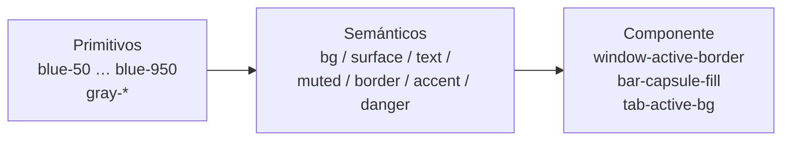

# 05 · Sistema de colores: de la imagen al token semántico

> Este documento aplica la metodología de **sistemas de color** (escalas primitivas →
> tokens semánticos → tokens de componente) al rice concreto del usuario. Incluye
> **contrastes calculados** sobre su paleta real y un plan para unificar sus dos
> fuentes de color.

## 1. Por qué "elegir colores" no es suficiente

En un rice, el color aparece en al menos siete sitios distintos: bordes de
Hyprland, barra del shell, GTK, Qt, terminal, editor y wallpaper. Si cada uno
tiene sus propios hex sueltos, cambiar el acento implica tocar siete archivos. Un
**sistema de color** resuelve esto con tres capas:



| Capa | Ejemplo | Quién la usa |
|---|---|---|
| **Primitiva** | `blue-500 = oklch(0.63 0.17 255)` | Solo el generador; jamás un widget |
| **Semántica** | `--accent`, `--surface`, `--danger` | Todos los componentes |
| **Componente** | `--button-primary-bg` | Casos muy específicos |

> Regla de oro: **los componentes consumen tokens semánticos; los temas cambian
> la capa semántica**. Nombres por rol (`danger`), nunca por apariencia (`red`).

Fuente metodológica: los principios de `color-systems` aplicados en esta
investigación; referencia de paleta comunitaria:
[Catppuccin README](../sources/2026-11-21-catppuccin-readme.md).

## 2. OKLCH: por qué importa

RGB y HSL no son perceptualmente uniformes: un `L=50%` amarillo parece mucho más
claro que un `L=50%` azul. **OKLCH** separa:

- **L** (lightness, 0–1): luminosidad perceptualmente uniforme.
- **C** (chroma): saturación; bajar C en los extremos evita salirse de gama.
- **H** (hue, 0–360): tono.

Ventajas para ricing:

1. Escalas de 10–12 pasos donde **pasos iguales se ven igual**.
2. Mantener H constante y bajar C en extremos → negros y blancos "limpios".
3. Generar variantes claro/oscuro de una misma paleta sin recalcular a ojo.

Ejemplo de escala primitiva en CSS (también portable a Lua/TOML como valores):

```css
:root {
  --blue-100: oklch(0.95 0.03 255);
  --blue-300: oklch(0.82 0.09 255);
  --blue-500: oklch(0.63 0.17 255);
  --blue-700: oklch(0.47 0.15 255);
  --blue-900: oklch(0.30 0.09 255);
}
```

Noctalia no expone OKLCH directamente, pero su generador **Material You** hace
algo equivalente: deriva tonos perceptualmente espaciados desde un color semilla.
Ver [Material Color Utilities](../sources/2026-11-21-material-you-color-system.md) y
[Noctalia palette](../sources/2026-11-21-noctalia-theming-palette.md).

## 3. Tu paleta real y sus contrastes (calculados)

Paleta oscura generada por Noctalia (`m3-tonal-spot`, modo `dark`):

| Rol semántico | Hex | Uso actual |
|---|---|---|
| `bg` | `#1e1e20` | fondo de kitty/alacritty/GTK |
| `surface` | `#27282a` | headerbar, popover, selección, tab inactiva |
| `text` | `#f2f2f3` | foreground |
| `muted` | `#afb1b6` | textos secundarios, borde inactivo |
| `accent` | `#6791e4` | foco, selección, borde de tab activa |
| `on-accent` | `#181d25` | texto sobre acento |
| `danger` / `error` | `#fd4663` | destructive, widget session |
| `link` | `#695cd6` | enlaces GTK |

### 3.1 Resultados WCAG 2.x (ratios calculados)

| Par | Ratio | Texto normal (≥4.5:1) | Texto grande / UI (≥3:1) |
|---|---:|:---:|:---:|
| `#1e1e20` / `#f2f2f3` (bg/text) | **14.88:1** | ✅ | ✅ |
| `#1e1e20` / `#afb1b6` (bg/muted) | **7.76:1** | ✅ | ✅ |
| `#27282a` / `#f2f2f3` (surface/text) | **13.19:1** | ✅ | ✅ |
| `#27282a` / `#afb1b6` (surface/muted) | **6.88:1** | ✅ | ✅ |
| `#6791e4` / `#181d25` (accent/on-accent) | **5.44:1** | ✅ | ✅ |
| `#1e1e20` / `#6791e4` (bg/accent) | **5.35:1** | ✅ | ✅ |
| `#1e1e20` / `#fd4663` (bg/danger) | **4.94:1** | ✅ | ✅ |
| `#1e1e20` / `#695cd6` (bg/link) | **3.25:1** | ❌ | ✅ |
| `#27282a` / `#6791e4` (surface/accent) | **4.74:1** | ✅ | ✅ |

**Conclusión:** la paleta es **muy buena** en contraste. El único punto débil es
`link` (`#695cd6`) sobre fondo: 3.25:1, insuficiente para texto normal. En GTK
aparece como `ForegroundLink`; conviene sustituirlo por un tono más claro
(p. ej. `#9f96e9`, que ya está en tu `color14`, ratio ~6:1) para texto, y reservar
`#695cd6` para fondos de botón con texto claro.

> **HECHO:** ratios calculados con la fórmula WCAG 2.x de luminancia relativa.
> **OPINIÓN:** no hace falta rediseñar la paleta, sólo reclasificar el rol `link`.

### 3.2 La segunda paleta: CachyOS green

`config/colors.lua` define otra paleta que **sí gobierna los bordes de Hyprland**:

| Token | Hex | Contraste sobre `#1e1e20` |
|---|---|---:|
| `CACHYLGREEN` | `#82dccc` | 10.35:1 ✅ |
| `CACHYDGREEN` | `#007d6f` | ~3.2:1 ⚠️ (sólo gráfico) |
| `CACHYGRAY` | `#798bb2` | 4.87:1 ✅ (justo para texto) |

El borde activo es un gradiente `#82dccc` → `#007d6f` a 45°. Es visualmente
agradable, pero **no comparte familia** con el azul/violeta M3 del resto del
escritorio. Es la inconsistencia número uno del rice.

## 4. Cómo genera color Noctalia (tu motor actual)

```
wallpaper → color semilla → esquema m3-tonal-spot → tokens → 7 plantillas
                                                      ├─ gtk3.css
                                                      ├─ gtk4.css
                                                      ├─ kcolorscheme
                                                      ├─ kitty.conf
                                                      ├─ qt
                                                      ├─ alacritty.toml
                                                      └─ btop.theme
```

Fuentes: [Noctalia theming](../sources/2026-11-21-noctalia-theming-index.md),
[paleta](../sources/2026-11-21-noctalia-theming-palette.md),
[app theming](../sources/2026-11-21-noctalia-app-theming.md),
[plantillas](../sources/2026-11-21-noctalia-templates.md),
[wallpaper](../sources/2026-11-21-noctalia-wallpaper.md).

`m3-tonal-spot` es una de las estrategias de *dynamic color* de Material 3:
toma un color dominante de la imagen y construye una paleta tonal. Si cambias de
wallpaper, **cambian los siete destinos**. Lo que no cambia es `colors.lua`.

### 4.1 Alternativas generativas (y cuál usar)

| Herramienta | Tipo | Entrada | Salida | Encaja contigo |
|---|---|---|---|---|
| Noctalia theme engine | Integrado | Wallpaper | 7 destinos + barra | ✅ Ya lo usas |
| [pywal](../sources/2026-11-21-pywal-readme.md) | CLI | Imagen | `colors.json`, secuencias 16 colores, plantillas | Referencia histórica |
| [wallust](../sources/2026-11-21-wallust-readme.md) | CLI (Rust) | Imagen | Paletas + plantillas, más rápido | Si quieres sustituir pywal |
| [matugen](../sources/2026-11-21-matugen-readme.md) | CLI (Rust) | Imagen | Esquemas M3 + plantillas | Muy alineado con tu M3 |
| [wpgtk](../sources/2026-11-21-gui-wpgtk.md) | **GUI** | Imagen + edición | Paletas editables + plantillas | Si quieres control manual |
| [Catppuccin](../sources/2026-11-21-catppuccin-readme.md) | Paleta curada | Ninguna | 4 varies (Latte/Frappe/Macchiato/Mocha) | Ya lo tienes en micro |

**Recomendación [OPINIÓN]:** quédate con Noctalia como fuente de verdad. Si quieres
más control, usa `matugen` (M3-compatible) o la GUI de `wpgtk`, pero **no dos a la vez**.

## 5. Plan de unificación en 4 pasos

### Paso 1 — Elegir fuente de verdad

Elige la paleta M3 de Noctalia (azul `#6791e4`). El verde CachyOS pasa a ser
un "acento de marca" opcional, no el color de los bordes.

### Paso 2 — Convertir `colors.lua` en derivado

Sustituye los hex fijos por los tokens de Noctalia. Noctalia ya incluye una
plantilla `assets/templates/hyprland/hyprland.lua` en el repo clonado; también
puedes hacerlo a mano:

```lua
-- config/colors.lua (derivado de la paleta M3)
CACHYLGREEN = "#6791e4"  -- acento (nombrelegacy, valor nuevo)
CACHYDGREEN = "#695cd6"  -- acento secundario
CACHYGRAY   = "#afb1b6"  -- borde inactivo / muted
CACHYWHITE  = "#f2f2f3"
```

> Mejor aún: renombrar a `ACCENT`, `ACCENT_ALT`, `MUTED`, `TEXT` y actualizar
> `decorations.lua` y `misc.lua`. Los nombres por rol sobreviven a los cambios
> de tema; los nombres por color no.

### Paso 3 — Añadir Hyprland a los templates de Noctalia

En `~/.config/noctalia/config.toml`:

```toml
[theme.templates]
builtin_ids = [ "btop", "gtk3", "gtk4", "kcolorscheme", "kitty", "qt", "alacritty", "hyprland" ]
```

### Paso 4 — Verificar

```bash
hyprctl getoption general:col:active_border
grep define-color ~/.config/gtk-3.0/noctalia.css | head
grep -E '^(background|foreground) ' ~/.config/kitty/themes/noctalia.conf
```

## 6. Reglas de diseño aplicadas (resumen accionable)

1. **Fondo gris oscuro, nunca `#000`**: tu `#1e1e20` es correcto; expresa
   elevación con `#27282a` en vez de sombras.
2. **Acentos desaturados en dark mode**: `#6791e4` funciona; evita azules
   neón puros sobre fondo oscuro (vibración).
3. **Borders importan más en dark mode** (las sombras desaparecen): tu
   `border_size=2` y `CACHYGRAY` cumplen.
4. **Texto nunca blanco puro**: `#f2f2f3` ya está atenuado. Bien.
5. **No confiar sólo en el color**: empareja `danger` con iconos/texto
   (el widget `session` ya usa `color="error"`, pero añade etiqueta).
6. **Modo claro**: si algún día lo activas, Noctalia puede generarlo; no
   inviertas simplemente los valores. Prueba contrastes de nuevo.
7. **Un acento para acciones primarias**: `#6791e4`. El violeta `#695cd6`
   queda para enlaces sobre fondos claros o decoración, no para ambas cosas.

## 7. Verificación automatizada (script)

```python
def luminance(hex_color):
    c = [int(hex_color[i:i+2], 16) / 255 for i in (1, 3, 5)]
    c = [x / 12.92 if x <= 0.03928 else ((x + 0.055) / 1.055) ** 2.4 for x in c]
    return 0.2126 * c[0] + 0.7152 * c[1] + 0.0722 * c[2]

def contrast(a, b):
    l1, l2 = sorted((luminance(a), luminance(b)), reverse=True)
    return (l1 + 0.05) / (l2 + 0.05)

assert contrast("#1e1e20", "#f2f2f3") >= 4.5
assert contrast("#27282a", "#afb1b6") >= 4.5
```

## 8. Fuentes

- [Catppuccin](../sources/2026-11-21-catppuccin-readme.md) ·
  [Material Color Utilities](../sources/2026-11-21-material-you-color-system.md)
- [Noctalia theming / palette / templates / app-theming](../sources/2026-11-21-noctalia-theming-index.md)
- [pywal](../sources/2026-11-21-pywal-readme.md) ·
  [wallust](../sources/2026-11-21-wallust-readme.md) ·
  [matugen](../sources/2026-11-21-matugen-readme.md) ·
  [wpgtk GUI](../sources/2026-11-21-gui-wpgtk.md)
- [perfil del sistema](../00-perfil-del-sistema.md) ·
  [arquitectura del rice](03-arquitectura-de-un-rice.md)
