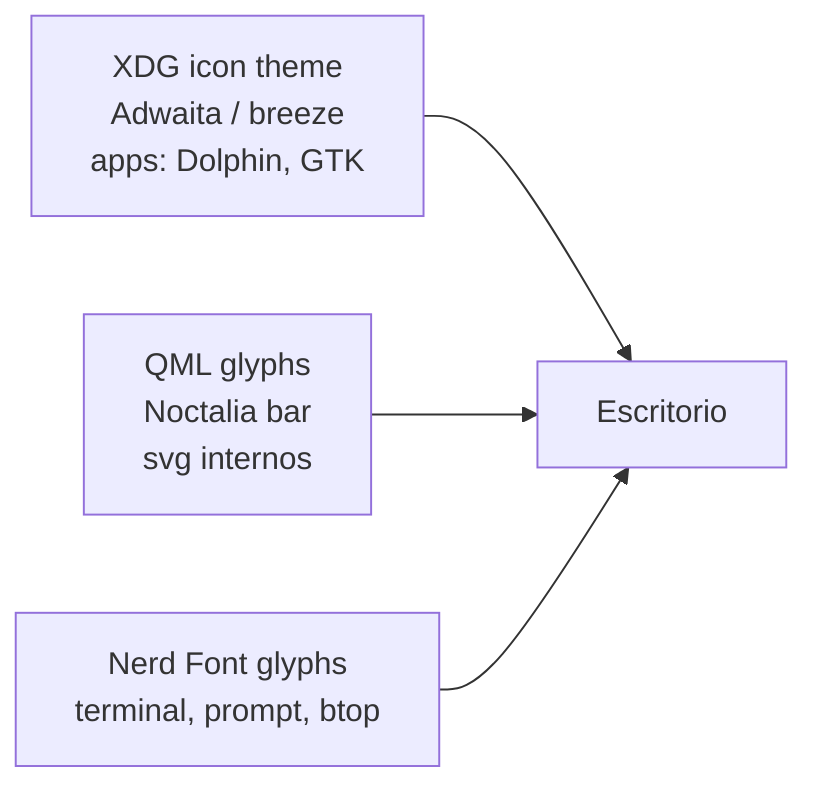

# 07 · Iconos y cursores: el lenguaje visual del rice

> Los iconos y el cursor son la "tipografía silenciosa" del escritorio: casi nadie
> los nombra, pero cualquier incoherencia se nota al instante. Aquí se aplican los
> principios de un **sistema de iconos** (SVG, `currentColor`, rejilla única,
> accesibilidad) al contexto de un rice Wayland.

## 1. Estado real en tu sistema

| Elemento | instalado | Configurado en |
|---|---|---|
| Cursor | **Bibata-Modern-Ice** (`~/.local/share/icons/Bibata-Modern-Ice`) | `gtk-3.0/settings.ini`: `gtk-cursor-theme-name=Bibata-Modern-Ice`, size 24; `xsettingsd.conf`: `Xft/CursorThemeName` |
| Temas de iconos | Adwaita, AdwaitaLegacy, breeze, breeze-dark, hicolor, locolor | GTK (`gtk-theme-name=adw-gtk3`), Dolphin/KDE (`kdeglobals`) |
| Iconos en barra | glyphs QML propios de Noctalia (`glyph = "gpu-usage"`, `"cpu-2"`) | `noctalia/config.toml` |
| Glyphs en terminal | Nerd Fonts (Fantasque/Meslo) + awesome-terminal-fonts + powerline-fonts | kitty/alacritty/fish pure prompt |
| Herramienta GUI | **nwg-look 1.2.1** | cambia tema GTK, iconos, cursor y fuentes |

Fuente: [perfil del sistema](../00-perfil-del-sistema.md) y `configuracion-actual/iconos/`.

## 2. Tres sistemas de iconos conviviendo (y por qué importa)



No son intercambiables:

| Sistema | Formato | Coloreable | Dónde usarlo |
|---|---|---|---|
| **XDG icon theme** | PNG/SVG en `icons/<tema>/<size>/<category>` | Parcial (SVG con `currentColor` en GTK4/libadwaita) | Aplicaciones, bandeja, file manager |
| **QML/SVG de Noctalia** | SVG embebido en QML | Sí, sigue el tema | Barra, panel, widgets |
| **Nerd Font glyphs** | Fuente con Private Use Area | Sí, hereda el color del texto | Terminal, prompt, statusline |

**Error común:** intentar usar un glyph de Nerd Font dentro de un botón GTK
dependiendo de que la fuente esté instalada. Si la fuente falta, sale un cuadrado
(•tofu•). En la barra de Noctalia usa sus glyphs QML; en la terminal usa Nerd Fonts.

## 3. Principios de un sistema de iconos (aplicados)

Tomados de la metodología `icon-systems` y traducidos al escritorio:

### 3.1 Un `viewBox`, un grosor de trazo

Si diseñas tus propios SVG para Noctalia o para un panel propio:

```svg
<svg xmlns="http://www.w3.org/2000/svg" viewBox="0 0 24 24"
     fill="none" stroke="currentColor" stroke-width="2"
     stroke-linecap="round" stroke-linejoin="round">
  <path d="M4 6h16M4 12h16M4 18h16"/>
</svg>
```

- `viewBox="0 0 24 24"` **siempre**; no lo quites nunca (sin él el icono no escala).
- Quita `width`/`height` del SVG fuente: el tamaño lo decide el contenedor (1em).
- Un solo `stroke-width` para toda la familia (2 es el estándar de Lucide).
- `currentColor` para iconos monocromos: así siguen automáticamente el tema
  claro/oscuro y el estado hover. Nunca `fill="#000"`.

### 3.2 Optimización con SVGO v4

```js
// svgo.config.mjs
export default {
  multipass: true,
  plugins: [
    'preset-default',
    'removeDimensions',
    { name: 'convertColors', params: { currentColor: true } },
    { name: 'removeAttrs', params: { attrs: ['data-name', 'class'] } },
  ],
}
```

```bash
npx svgo -f icons -o icons-optimized --config svgo.config.mjs
grep -L 'viewBox' icons-optimized/*.svg     # debe no imprimir nada
grep -l 'fill="#' icons-optimized/*.svg     # sólo los policromos intencionados
```

> Nota: SVGO v4 ya no incluye `removeViewBox` en `preset-default`. No lo
> reañadas: sin `viewBox` el icono se recorta al escalar.

### 3.3 Accesibilidad (aunque sea un escritorio)

- Un icono **decorativo** junto a texto → `aria-hidden="true"` / `visible: false`.
- Un botón **sólo icono** → nombre accesible en el contenedor, no en el SVG.
- Un icono con **significado** sin texto → `role="img"` + etiqueta.
- Contraste mínimo **3:1** para iconos con significado (WCAG 1.4.11). Tu
  `#afb1b6` sobre `#1e1e20` da 7.76:1 ✅; `#798bb2` da 4.87:1 ✅.

## 4. Cursores: más de lo que parece

Bibata-Modern-Ice es una buena elección: cursor **SVG con sombra**, legible sobre
fondos claros y oscuros, y con variantes modificadas. Puntos a revisar:

1. **Tamaño coherente**: `gtk-cursor-theme-size=24` y `Xcursor.size` deben
   coincidir con la escala del monitor (aquí `scale=1` → 24 px correcto).
2. **XWayland**: las apps X11 pueden usar el cursor de Xresources en vez del
   de GTK. Tu `xsettingsd.conf` ya lo declara, así que debería propagarse.
3. **HiDPI**: si conectas un monitor 4K, Bibata tiene variantes con mayor `Xcursor.size`.
4. **Cambio en caliente**: `nwg-look` aplica el cursor; en Wayland puede
   requerir reiniciar la sesión para que todas las apps lo recojan.
5. **No mezcles themes por app**: un cursor distinto en Firefox y en Dolphin
   rompe la ilusión de rice coherente.

Verificación:

```bash
cat ~/.icons/default/index.theme           # Inherits=Bibata-Modern-Ice
find ~/.local/share/icons/Bibata-Modern-Ice/cursors -maxdepth 1 | head
echo $XCURSOR_THEME $XCURSOR_SIZE
```

## 5. Iconos en la barra de Noctalia

Tu config ya usa `glyph` en varios widgets:

```toml
[widget.sysmon_2]
glyph = "gpu-usage"
stat = "gpu_temp"

[widget.sysmon_3]
glyph = "cpu-2"
stat = "ram_used"
```

Recomendaciones:

- Mantén **un solo estilo** de glyph (Noctalia provee los suyos). Mezclar un
  glyph QML con un carácter Nerd Font en el mismo `capsule_group` se nota.
- Si el glyph no existe, Noctalia suele mostrar un placeholder: revisa los IDs
  disponibles en el repo clonado (`repositorios/noctalia`, carpeta de assets).
- El `capsule_group g1` (`temp` + `gpu` + `ram`) es un buen patrón: agrupa
  iconos relacionados bajo un mismo `fill = "on_secondary"`.

Fuente: [Noctalia bar](../sources/2026-11-21-noctalia-bar.md).

## 6. Relación con Nerd Fonts

Nerd Fonts es, técnicamente, un **icon font**: parchea fuentes con miles de
glyphs en el Private Use Area. Ventajas e inconvenientes frente a SVG:

| | Icon font (Nerd Fonts) | SVG |
|---|---|---|
| Nitidez | Depende de la fuente; puede verse borroso | Nítido a cualquier tamaño |
| Si la fuente falta | Aparece "tofu" | No aplica |
| Coloreado | Hereda `color` (monocromo) | `currentColor` o multicolor |
| Accesibilidad | Lectores de pantalla pueden leer el carácter | Controlable con `aria-hidden` |
| Tamaño | Una fuente para todo | Un archivo por icono |

> **Regla:** en terminal y prompt, Nerd Fonts; en interfaces gráficas, SVG.
> Nunca uses Nerd Fonts en un botón GTK/Qt crítico sin fallback.

Tu terminal ya declara `font_family` implícitamente como `monospace` en
alacritty; declara explícitamente `MesloLGM Nerd Font` o `FantasqueSansM Nerd Font Mono`
para garantizar los glyphs. Ver [06-tipografia.md](06-tipografia.md).

## 7. Plan de acción para tu rice

| Prioridad | Acción | Comando / archivo |
|---|---|---|
| Alta | Fijar explícitamente la fuente Nerd en kitty y alacritty | `kitty.conf`, `alacritty.toml` |
| Alta | Verificar herencia del cursor | `~/.icons/default/index.theme` |
| Media | Unificar estilo de glyphs en la barra | `noctalia/config.toml` |
| Media | Si haces iconos propios: rejilla 24 + `currentColor` + SVGO | `svgo.config.mjs` |
| Baja | Probar `nwg-look` para cambiar tema de iconos en vivo | `nwg-look` |
| Baja | Añadir etiquetas accesibles si creas tu GUI (ver doc 15) | GTK4 `accessible-label` |

## 8. Fuentes

- [Nerd Fonts README](../sources/2026-11-21-nerd-fonts-readme.md) y
  [sitio oficial](../sources/2026-11-21-nerd-fonts-website.md)
- [Bibata Cursor README](../sources/2026-11-21-bibata-readme.md)
- [Noctalia bar](../sources/2026-11-21-noctalia-bar.md)
- [adw-gtk3](../sources/2026-11-21-adw-gtk3-readme.md)
- [perfil del sistema](../00-perfil-del-sistema.md)
