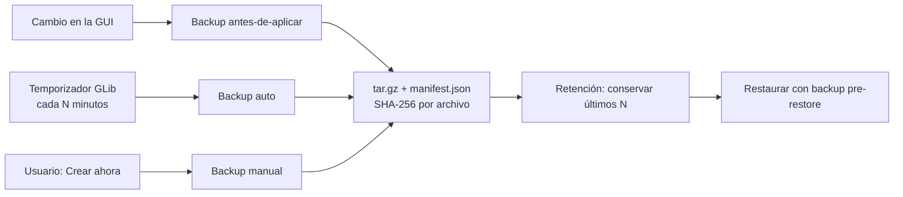

# 15 · Crear tu propia GUI de ricing: qué hacer y en qué idioma

> Respondiendo a tu pregunta directa. Hay dos "idiomas" en juego:
> **(a) el lenguaje de programación / toolkit** y **(b) el idioma de los textos de la interfaz**.
> Ambos se responden abajo, con decisiones basadas en lo que **ya tienes instalado**.

## 1. Lo que ya tienes (auditoría del toolchain)

| Tecnología | Estado en tu CachyOS | Sirve para |
|---|---|---|
| **Python 3.14.9** | ✅ Instalado | Lógica, lectura/escritura de configs |
| **PyGObject 3.58.1** | ✅ Instalado | Enlazar GTK desde Python |
| **GTK 4.24.1** | ✅ Instalado | Widgets modernos |
| **libadwaita 1.10.0** | ✅ Instalado | Look nativo, `Adw.*`, preferences, dark mode |
| **Qt6 6.12 + Qt6 Declarative + `qml`/`qmlscene`** | ✅ Instalado | QML (el mismo stack de Noctalia) |
| **tomllib** (stdlib Python 3.11+) | ✅ | Leer `config.toml` de Noctalia |
| Rust / cargo | ❌ No instalado | Descartado salvo que quieras instalar toolchain |
| Node / npm | ❌ No instalado | Descartado (Electron/Tauri) |
| Go | ❌ No instalado | Descartado |
| `gcc`, `cmake`, `pkg-config` | ✅ | Compilar si hiciera falta |
| `hyprmod` clonado en `repositorios/hyprmod` | ✅ | **Código real de referencia** (GPL-3.0) |

**Conclusión rápida:** no necesitas instalar casi nada. La respuesta corta es:
**Python + GTK4 + libadwaita**, con los textos de la interfaz en **español pero
externalizados desde el primer día** (gettext). Si lo que quieres es una barra
animada tipo Noctalia en lugar de un panel de ajustes, entonces **QML (Qt6)**.

## 2. Decisión: qué lenguaje/toolkit elegir

| Opción | Por qué sí | Por qué no | Veredicto |
|---|---|---|---|
| **Python + GTK4/libadwaita** | Ya instalado; misma stack que `hyprmod`; `Adw.PreferencesPage` te da un panel de ajustes listo; Python lee TOML y escribe Lua/JSON con facilidad; gran cantidad de ejemplos | Python 3.14 es muy nuevo (algunas libs pueden ir por detrás) | ⭐ **Elige esto** |
| **QML / Qt Quick (Qt6)** | Es lo que usa Noctalia; animaciones fluidas; integración natural con Wayland; `qml`/`qmlscene` disponibles | Más curva de aprendizaje; QML+JS/C++ para lógica; depurar es más incómodo | ⭐ Si quieres una **barra/shell**, no un panel de ajustes |
| **Python + GTK3** | `nwg-look` lo usa; muy estable | GTK3 es legacy; peor integración con libadwaita | Solo para mantener compatibilidad |
| **Rust + Slint / iced / relm4** | Muy rápido y moderno | No tienes Rust instalado; más tiempo hasta ver resultado | Más adelante, no ahora |
| **Electron / Tauri (web)** | Familiar si vienes de web | Node no instalado; pesado; innecesario para un panel pequeño | ❌ |
| **Bash + `zenity`/`yad`** | Cero dependencias | Limitado, frágil, difícil de mantener | Solo para un prototipo de 20 minutos |
| **EWW / AGS** | Declarativo (YAML+CSS / GJS) para widgets de escritorio | Están pensados para barras y popups, no para un "settings app" con formularios | Complemento, no reemplazo |

Fuente de la comparación: [hyprmod README](../sources/2026-11-21-gui-hyprmod.md) (GTK4+libadwaita,
Python 3.12+), [Noctalia README](../sources/2026-11-21-noctalia-readme.md) (QML),
[perfil del sistema](../00-perfil-del-sistema.md).

> **HECHO:** hyprmod —la GUI más completa que encontramos para Hyprland— está
> escrita en Python 3.12+ con GTK4 y libadwaita. **OPINIÓN:** seguir esa misma
> stack te permite leer su código clonado como plantilla.

## 3. Arquitectura recomendada (cómo hacerlo bien)

No escribas un programa que "edite tu `hyprland.lua` a texto libre". Eso es lo que
rompe configuraciones. Usa un patrón de **tres capas**:

```mermaid
flowchart LR
    GUI[Tu GUI<br/>Python + GTK4] -->|1. lee| STATE[ui-settings.lua<br/>estado persistido]
    GUI -->|2. mover control = apply en vivo<br/>(debounce 120 ms)| HYPR[hyprctl eval hl.config{...}<br/>noctalia msg ...]
    GUI -->|3. botón Guardar = sólo persiste<br/>(con backup)| STATE
    STATE -->|require| LUA[tu hyprland.lua modular]
    LUA --> HYPR
    GUI -->|guarda/escribe| TOML[noctalia/config.toml]
    GUI -->|escribe| KIT[kitty.conf / colors.lua]
```

**Reglas de oro:**

1. **El estado vive en un archivo pequeño y generado**, no repartido por 13 módulos.
2. **Nunca sobrescribas sin backup**: copia el archivo a `.bak` con timestamp.
3. **Live preview primero**: en Hyprland 0.57 usa `hyprctl eval 'hl.config({...})'`
   (`hyprctl keyword` devuelve *unknown request* desde la deprecación de `.conf`); el archivo sólo
   se escribe al pulsar "Guardar" (o al aplicar, pero con deshacer).
4. **Validación antes de escribir**: rangos numéricos, booleanos, rutas existentes.
5. **No pedir root**: todo está en `~/.config`.
6. **No meter secretos** en el repo de dotfiles.

### 3.1 El archivo de estado (Lua, para encajar con tu config)

`~/.config/hypr/config/ui-settings.lua`:

```lua
-- Generado por hypr-rice-gui. NO EDITAR A MANO.
return {
  rounding   = 10,
  blur       = true,
  blur_size  = 5,
  blur_passes = 4,
}
```

En tu `hyprland.lua`, **antes** de `require("config.decorations")`:

```lua
UI_SETTINGS = require("config.ui-settings")
```

Y en `config/decorations.lua`, sustituye los literales:

```lua
rounding = UI_SETTINGS.rounding,
blur = {
    size = UI_SETTINGS.blur_size,
    passes = UI_SETTINGS.blur_passes,
    special = UI_SETTINGS.blur,
},
```

Así la GUI no parsea Lua: **genera** un módulo Lua que tu config ya entiende.

### 3.2 Backups automáticos (requisito obligatorio)

La GUI **debe** hacer backups automáticos: antes de cada cambio, de forma
periódica mientras está abierta, y con posibilidad de restaurar. El prototipo ya
incluye `backup_manager.py` con este diseño:



| Característica | Implementación |
|---|---|
| **Qué se respalda** | `~/.config/hypr`, `noctalia/config.toml`, `kitty`, `alacritty`, `gtk-3.0`, `fish/config.fish`, `color-schemes` |
| **Cuándo** | Antes de cada "Aplicar", cada N minutos (por defecto 15), y bajo demanda |
| **Dónde** | `~/.local/share/hypr-rice-gui/backups/` |
| **Formato** | `backup-YYYYmmdd-HHMMSS-<motivo>.tar.gz` con `manifest.json` y `data/` |
| **Integridad** | SHA-256 por archivo; `verify_backup()` detecta cambios |
| **Retención** | `keep_last` (por defecto 10); borra los antiguos automáticamente |
| **Seguridad** | Antes de restaurar hace un backup `pre-restore`; excluye `fish_variables`, keyrings y cachés |
| **Configuración** | `~/.local/share/hypr-rice-gui/settings.json` (switch, intervalo, retención) |
| **Historial de puntos en el pasado** | `get_backup_details()` (manifiesto), `read_file_from_backup()` (ver un archivo sin extraer), `compare_with_current()` (modificados/ausentes/iguales), `delete_backup()`, `restore_backup()` |
| **GUI** | Switch, intervalo, retención; lista de todos los backups con fecha/motivo/tamaño; selector de archivos; botones **Ver archivo**, **Comparar**, **Restaurar**, **Borrar**, **Crear ahora** |
| **Vista previa en vivo** | Mover el slider de `rounding` o el switch de `blur` ejecuta `hyprctl eval "hl.config({decoration={rounding=N, blur={enabled=bool}}}})"` con un *debounce* de 120 ms: el cambio se ve al instante. El botón **Guardar configuración** **ya no aplica**, sólo persiste en `ui-settings.lua` (tras backup) |
| **Navegación por categorías** | `Gtk.Stack` + `Gtk.StackSwitcher` con cuatro pestañas: **Apariencia**, **Backups**, **Historial** e **Identidad** |

API del módulo:

```python
import backup_manager as bm

bm.create_backup(reason="manual")     # devuelve el manifiesto
bm.list_backups()                     # historial
bm.verify_backup("backup-....tar.gz") # (bool, mensaje)
bm.restore_backup("backup-....tar.gz")# (bool, mensaje)

# Explorar puntos en el pasado
bm.get_backup_details("backup-....tar.gz")       # manifiesto completo
bm.read_file_from_backup("backup-....tar.gz", "home/usuario/.config/kitty/kitty.conf")
bm.compare_with_current("backup-....tar.gz")     # {'changed': [...], 'missing': [...], 'same': [...]}
bm.delete_backup("backup-....tar.gz")
```

> **HECHO:** el código está en `recursos/hypr-rice-gui/backup_manager.py` y se
> integró en `main.py` (temporizador `GLib.timeout_add_seconds`, limpieza al cerrar
> la ventana y backup antes de `save_state`). Probado: creación, listado,
> verificación y restauración exitosas.

## 4. Plan de trabajo en 6 pasos

### Paso 0 — Aprende del código real (30 min)

```bash
ls -R ~/ricing/repositorios/hyprmod | head -60
cat ~/ricing/repositorios/hyprmod/README.md
```

Fíjate en cómo hace *live preview*, *pending changes* y *undo*. No copies su código
(GPL-3.0): úsalo como referencia de arquitectura.

### Paso 1 — Prototipo mínimo (1-2 h)

Un window con un slider de `rounding` y un switch de `blur`. Objetivo: ver el
cambio en pantalla al mover el control.

### Paso 2 — Persistencia con backup (1 h)

Escribir `ui-settings.lua` con `shutil.copy2()` previo a `.bak`.

### Paso 3 — Leer la config existente (1 h)

`subprocess.run(["hyprctl", "getoption", "decoration:rounding"], ...)` para
inicializar los controles con el valor real. Para Noctalia: `tomllib.load()` de
`~/.config/noctalia/config.toml`. (Para **escribir** TOML, instala `tomlkit` con
`pip install --user tomlkit`, o genera el archivo con plantillas.)

### Paso 4 — Más páginas (según necesidad)

- **Colores**: editar `colors.lua` y disparar Noctalia theme.
- **Fuentes**: selector que escriba `font_family` en kitty/alacritty.
- **Keybinds**: cuidado con AZERTY: ofrece always `code:` como opción.
- **Perfiles**: guarda snapshots de `ui-settings.lua` (como `hyprmod profile`).

### Paso 5 — Empaquetado y arranque

```bash
mkdir -p ~/.local/share/applications ~/Proyectos/hypr-rice-gui
# .desktop con Exec=/usr/bin/python3 %u ... o un wrapper
```

Opcional: añadir un entrada en Noctalia launcher y un atajo en `binds.lua`.

### Paso 6 — Idioma de la interfaz (ver sección 6) y publicación

Si lo haces público: LICENSE, README con capturas y `git` (ver
[10-dotfiles-y-gestion.md](10-dotfiles-y-gestion.md)).

## 5. Esqueleto de código funcional (Python + GTK4 + libadwaita)

Guardado también como [`recursos/hypr-rice-gui/main.py`](../recursos/hypr-rice-gui/main.py).
Es un punto de partida deliberadamente pequeño: **rounding + blur**, con apply en
vivo y persistencia segura.

```python
#!/usr/bin/env python3
"""Prototipo de GUI de ricing: rounding + blur para Hyprland 0.57."""
import gettext
import os
import shutil
import subprocess
from datetime import datetime
from pathlib import Path

import gi

gi.require_version("Gtk", "4.0")
gi.require_version("Adw", "1")
from gi.repository import Adw, Gtk  # noqa: E402

# --- i18n: español como idioma base, pero externalizado ---
gettext.bindtextdomain("hypr-rice-gui", os.path.expanduser("~/.local/share/locale"))
gettext.textdomain("hypr-rice-gui")
_ = gettext.gettext

STATE = Path.home() / ".config/hypr/config/ui-settings.lua"


def hyprctl(*args: str) -> str:
    """Ejecuta hyprctl y devuelve stdout (o '' si falla)."""
    try:
        return subprocess.run(["hyprctl", *args], capture_output=True,
                              text=True, timeout=5).stdout.strip()
    except (OSError, subprocess.SubprocessError):
        return ""


def current_rounding() -> int:
    out = hyprctl("getoption", "decoration:rounding")
    # 'decoration:rounding = 10'
    try:
        return int(out.split("=", 1)[1].strip().split(" ")[0])
    except (IndexError, ValueError):
        return 10


def save_state(rounding: int, blur: bool, size: int, passes: int) -> None:
    STATE.parent.mkdir(parents=True, exist_ok=True)
    if STATE.exists():
        stamp = datetime.now().strftime("%Y%m%d-%H%M%S")
        shutil.copy2(STATE, STATE.with_suffix(f".lua.bak-{stamp}"))
    STATE.write_text(
        "-- Generado por hypr-rice-gui. NO EDITAR A MANO.\n"
        "return {\n"
        f"  rounding = {rounding},\n"
        f"  blur = {str(blur).lower()},\n"
        f"  blur_size = {size},\n"
        f"  blur_passes = {passes},\n"
        "}\n",
        encoding="utf-8",
    )


def on_activate(app: Adw.Application) -> None:
    win = Adw.ApplicationWindow(application=app, title=_("Ricing GUI"))
    win.set_default_size(420, 360)

    page = Adw.PreferencesPage()
    group = Adw.PreferencesGroup(title=_("Apariencia de ventanas"))
    page.add(group)

    # --- Rounding ---
    row_r = Adw.ActionRow(title=_("Redondeo"), subtitle=_("Radio de esquinas (px)"))
    scale = Gtk.Scale.new_with_range(Gtk.Orientation.HORIZONTAL, 0, 30, 1)
    scale.set_value(current_rounding())
    scale.set_hexpand(True)
    row_r.add_suffix(scale)
    group.add(row_r)

    # --- Blur ---
    row_b = Adw.ActionRow(title=_("Blur"), subtitle=_("Desenfoque de ventanas"))
    switch = Gtk.Switch()
    switch.set_active(True)
    switch.set_valign(Gtk.Align.CENTER)
    row_b.add_suffix(switch)
    group.add(row_b)

    status = Gtk.Label(label=_("Sin aplicar"), margin_top=12)
    box = Gtk.Box(orientation=Gtk.Orientation.VERTICAL, spacing=12, margin=18)
    box.append(page)
    box.append(status)
    win.set_content(box)

    def apply(_btn: Gtk.Button) -> None:
        r = int(scale.get_value())
        b = switch.get_active()
        hyprctl("keyword", "decoration:rounding", str(r))
        hyprctl("keyword", "decoration:blur:enabled", str(b).lower())
        save_state(r, b, 5, 4)
        status.set_label(_("Aplicado y guardado ✓"))

    btn = Gtk.Button(label=_("Aplicar y guardar"))
    btn.connect("clicked", apply)
    box.append(btn)
    win.present()


if __name__ == "__main__":
    app = Adw.Application(application_id="com.tu.hypr-rice-gui")
    app.connect("activate", on_activate)
    raise SystemExit(app.run(None))
```

**Ejecutar:**

```bash
python3 ~/ricing/recursos/hypr-rice-gui/main.py
```

Si `Adw.ApplicationWindow` te da problemas en tu versión, cambia a
`Gtk.ApplicationWindow` con `Gtk.Box` —el resto del código no cambia.

## 6. ¿En qué idioma escribirlo? (tu pregunta literal)

### 6.1 Lenguaje de programación

**Python 3.14 + GTK4/libadwaita (PyGObject)**, por las razones de la sección 2.
Es el que menos fricción te da hoy: no instalas nada, y tienes el código de
`hyprmod` al lado para inspirarte.

### 6.2 Idioma de los textos de la interfaz

**Escribe los textos visibles en español**, pero **no los escribas "a pelo"**:
envuélvelos en `_()` desde el primer día, como en el ejemplo (`_("Redondeo")`).
Eso cuesta cero ahora y te permite añadir inglés después sin reescribir la GUI.

Recomendación práctica:

- Idioma base: **español** (es tu idioma y el de esta investigación).
- Usa `gettext` (como arriba) o, si prefieres algo más simple, un dict
  `STRINGS = {"es": {...}, "en": {...}}` y una función `t(key)`.
- Evita mezclar: no pongas "Apply" en un botón y "Redondeo" en otro.
- Los nombres de archivo/rutas/comandos (`hyprctl`, `rounding`) se dejan en inglés
  técnico, como corresponde.
- Si algún día lo publicas, añade un `LICENSE` y un `README.md` en español con
  capturas (tu `swash` ya está configurado para capturar).

### 6.3 Idioma de los archivos de configuración que genera

| Archivo | Idioma/formato | Por qué |
|---|---|---|
| `ui-settings.lua` | Lua (sintaxis Hyprland) | Lo consume tu `hyprland.lua` |
| `noctalia/config.toml` | TOML | Formato nativo de Noctalia |
| `kitty.conf` / `alacritty.toml` | Su formato | Los leen esos programas |
| Comentarios generados | **Español** | Los lees tú |

## 7. Trampas específicas de tu sistema

1. **AZERTY + `code:`**: si haces editor de atajos, captura el *keycode físico*
   (`hyprctl` / eventos `code:`) y ofrece siempre la opción `code:` como en tu
   `digitCode(d)`.
2. **Noctalia ya reescribe configs**: tu GUI y Noctalia pueden pisarse si ambos
   escriben `kitty.conf` o GTK CSS. Decide quién manda: propón que tu GUI **sólo**
   escriba `ui-settings.lua` y deje el theming a Noctalia.
3. **Config modular**: inserta el `require("config.ui-settings")` en la posición
   correcta (`decorations.lua` lo necesita).
4. **Sin VRR/HDR**: no ofrezcas toggles que tu GPU no soporta.
5. **Python 3.14**: comprueba que cualquier librería extra (p. ej. `tomlkit`)
   tenga wheel para 3.14; si no, usa `python3 -m pip install --user` con
   `--break-system-packages` sólo en un venv, nunca en el sistema.

## 8. Recursos guardados para esta sección

- Código de referencia: [`repositorios/hyprmod/`](../repositorios/hyprmod).
- Documento de herramientas GUI: [14-herramientas-gui-de-ricing.md](14-herramientas-gui-de-ricing.md).
- Fuentes: [hyprmod](../sources/2026-11-21-gui-hyprmod.md),
  [Noctalia README](../sources/2026-11-21-noctalia-readme.md),
  [Hyprland Lua utilities](../sources/2026-11-21-hyprland-lua-utilities.md).
- Esqueleto ejecutable: [`main.py`](../recursos/hypr-rice-gui/main.py) y
  [`backup_manager.py`](../recursos/hypr-rice-gui/backup_manager.py) (backups automáticos).
