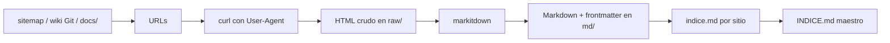

# 16 · Archivo web oficial: todas las páginas que cumplen

> Este documento describe el **archivo web** creado para responder a la petición
> de copiar "absolutamente todas las páginas web que cumplan". El índice maestro
> está en [`archivo-web/INDICE.md`](../archivo-web/INDICE.md).

## 1. Criterio de inclusión

Se archivó **toda página web que sea documentación oficial** de:

1. El compositor **Hyprland** y su ecosistema directo (wiki oficial, hyprpaper,
   hyprlock, hypridle, hyprpicker, hyprcursor, hyprland-guiutils, portal XDG).
2. Herramientas que **se integran con Hyprland para hacer ricing**: shells
   (Noctalia, AGS, eww, nwg-shell), barras (Waybar), launchers (rofi, wofi),
   notificaciones (dunst, mako, SwayNotificationCenter), capturas (swash),
   wallpaper/theming (pywal, wallust, matugen, wpgtk, Themix, Catppuccin),
   fuentes (Nerd Fonts), iconos/cursores (Bibata), temas GTK/Qt (adw-gtk3,
   Kvantum, nwg-look) y utilidades (fastfetch, hyprmod).
3. Sitios web oficiales con documentación accesible.

**Se excluyen**: tutoriales de terceros, foros, blogs, videos y contenido no
oficial. Esos tipos de fuentes ya se usaron con moderación en `sources/` pero no
forman parte de este archivo.

## 2. Resultados

| Métrica | Valor |
|---|---:|
| Sitios/dominios archivados | **42** |
| Páginas archivadas | **744** |
| Tamaño en disco | **~53 MB** |
| Formato por página | HTML crudo (`raw/`) + Markdown (`md/`) |

### Desglose por tipo de fuente

| Grupo | Páginas | Ejemplos |
|---|---:|---|
| Wiki oficial de Hyprland (sitemap completo) | 123 | `hyprland-wiki/` |
| Wikis oficiales de GitHub | 274 | Waybar (84), fastfetch (90), Nerd Fonts (21), rofi (19)… |
| Documentación de repositorios oficiales | 268 | Noctalia (106), wallust (38), dotfiles de referencia, hyprpaper, hyprlock… |
| Sitios web oficiales | 79 | hyprland.org (30), AGS docs (44), catppuccin.com (7), nerd-fonts.com (6)… |

## 3. Cómo se hizo



Scripts en `apendices/`:

- `crawler.py` — descubre URLs internas de un sitio oficial (mismo host, profundo
  pero con límite; respeta extensions binarias).
- `archivar-web.py` — descarga y convierte una lista de URLs.
- `archivar-wikis.py` — convierte wikis de GitHub clonadas en `.wiki.git`.
- `archivar-repo.py` — convierte todo el Markdown de un repo oficial clonado.
- `generar-indice-web.py` — regenera el índice maestro.

### Frontmatter de cada página

```yaml
---
type: source
source_type: webpage   # o doc
url: "https://wiki.hypr.land/configuring/core/animations/"
title: "…"
fetched_at: 2026-11-22T…
fetcher: "curl + markitdown"
site: "wiki.hypr.land"
---
```

> **Regla cumplida:** el cuerpo de cada archivo sale de `curl` + `markitdown` (o
> es el Markdown original de una wiki/repo oficial). **Ningún cuerpo se escribió
> a mano**.

## 4. Fallos y limitaciones conocidas

| Situación | Detalle |
|---|---|
| `eww.yujicode.com` | No respondió; se archivó la documentación oficial del repo `elkowar/eww` (14 páginas) |
| `nwg-piotr.github.io/nwg-*` | Los subsitios enlazados devuelven 404; se conservó la homepage y las wikis/repo de nwg-shell |
| `docs.catppuccin.com` | No expone sitemap; se archivó `catppuccin.com` (7 páginas) |
| `matugen.org`, `wallust.exquisite.wall` | No respondieron; se archivaron sus wikis y repos oficiales |
| Páginas JS-heavy | markitdown puede capturar menos contenido; el HTML crudo se conserva en `raw/` |
| Límites del crawler | Máximo 50 URLs y profundidad 3 por sitio para evitar descargas descontroladas |

Cada sitio con fallos guarda un `fallos.json` con la URL y el motivo.

## 5. Cómo explorar el archivo

```bash
cd archivo-web
cat INDICE.md                                  # resumen y enlaces
cat hyprland-wiki/indice.md                    # páginas de la wiki de Hyprland
sed -n '1,20p' docs-noctalia/md/0042-*.md      # una página concreta
grep -rl 'wobble' . --include='*.md' | head     # buscar en todo el archivo
```

## 6. Relación con el resto del proyecto

- `sources/` contiene las **49 fuentes citadas** en los documentos de investigación.
- `archivo-web/` contiene **toda la documentación oficial disponible**, citada o no.
- Los documentos de `investigacion/` citan `sources/`; este archivo es la reserva
  documental para profundizar sin depender de que un sitio siga online.

## 7. Fuentes

- [`archivo-web/INDICE.md`](../archivo-web/INDICE.md)
- Índices individuales: `archivo-web/<sitio>/indice.md`
- Scripts: `apendices/crawler.py`, `archivar-web.py`, `archivar-wikis.py`,
  `archivar-repo.py`, `generar-indice-web.py`
